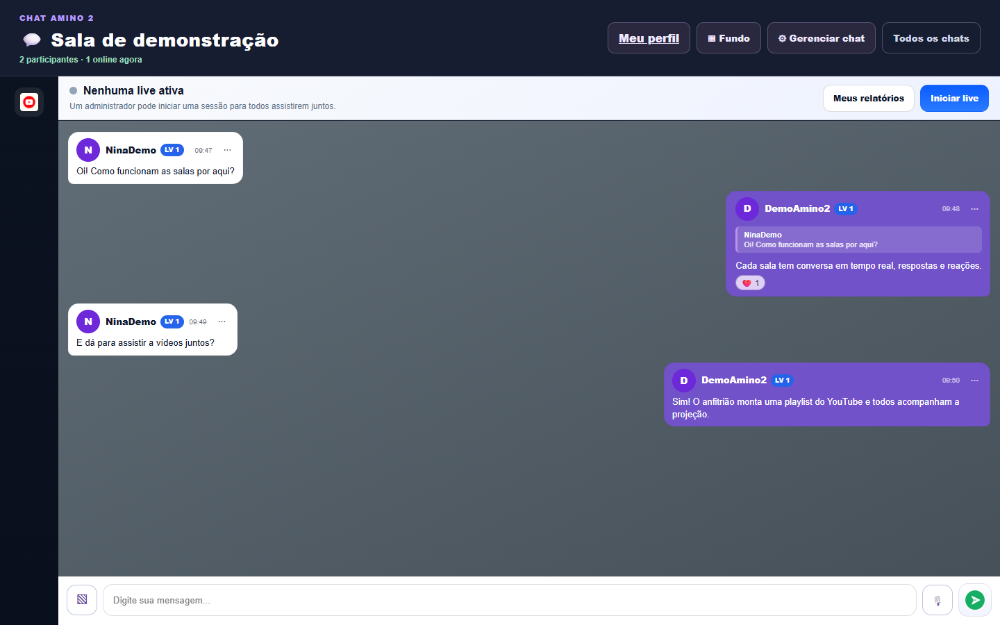

# Chat Amino 2

Plataforma de comunidades com salas de conversa em tempo real, perfis sociais e projeções sincronizadas de vídeos do YouTube. A aplicação reúne interface web, API e Socket.IO em um servidor Node.js, com dados persistidos em PostgreSQL.

## Visão do produto

Capturas reais da aplicação, feitas com perfis e conversa fictícios. É possível conhecer a interface sem criar uma conta.

**Salas públicas**


**Chat em tempo real**



[Ver também o perfil demonstrativo](docs/images/perfil-demo.png).

## Funcionalidades

- **Contas e perfis:** cadastro, login com JWT, edição de perfil, avatar e banner.
- **Salas de chat:** criação e descoberta de salas públicas, presença online, histórico de mensagens e funções de proprietário, coadministrador e membro.
- **Conversas enriquecidas:** mensagens de texto e áudio, respostas, reações, figurinhas com biblioteca pessoal e fundos de chat por usuário e sala.
- **Projeções de vídeo:** sessões compartilhadas com playlist do YouTube, reprodução sincronizada, controles do anfitrião e resumo da sessão. Há recursos de miniplayer e janela flutuante conforme o suporte do navegador.
- **Comunidade e reputação:** posts, curtidas, seguidores, check-in, XP, níveis, ranking e recompensas por participação.
- **Administração:** gerenciamento de usuários e salas por contas com permissão de administrador do site.

## Arquitetura

```text
public/                Páginas HTML, estilos e JavaScript do navegador
src/server.js          Entrada do servidor HTTP, API e eventos Socket.IO
src/routes/            Endpoints REST de autenticação, salas, chat e comunidade
src/controllers/       Regras dos endpoints de autenticação e perfil
src/services/          Reputação, projeções, mensagens e armazenamento de mídia
src/middleware/        Autenticação e autorização
src/database/          Cliente Prisma
prisma/                Schema e migrações do PostgreSQL
test/                  Testes automatizados
```

O Express entrega os arquivos de `public/` e expõe a API em `/api`. O navegador usa requisições HTTP para operações persistentes e Socket.IO para chat, presença e sincronização das projeções. O Prisma acessa o PostgreSQL; o estado temporário das sessões de vídeo fica no processo do servidor. Arquivos do chat podem ser armazenados no Cloudinary, em um bucket S3 compatível ou, durante o desenvolvimento, em uma pasta local privada. Avatar e banner de perfil são armazenados no banco.

## Tecnologias

| Camada | Tecnologias |
| --- | --- |
| Interface | HTML, CSS e JavaScript sem framework; YouTube IFrame API |
| Servidor e tempo real | Node.js 22+, Express 5 e Socket.IO 4 |
| Dados | PostgreSQL, Prisma ORM e migrações |
| Autenticação | JWT e bcrypt |
| Mídia | Multer, Sharp, Cloudinary e AWS SDK para S3 compatível |
| Testes | `node:test` |

## Executar localmente

**Pré-requisitos:** Node.js 22 ou superior, npm e uma instância PostgreSQL acessível.

1. Instale as dependências:

   ```bash
   npm ci
   ```

2. Copie `.env.example` para `.env` e configure, no mínimo, `DATABASE_URL` e `JWT_SECRET`. Em PowerShell:

   ```powershell
   Copy-Item .env.example .env
   ```

   Use uma chave JWT longa e aleatória. O `PORT` padrão é `3000`.

3. Aplique as migrações e gere o cliente Prisma:

   ```bash
   npx prisma migrate deploy
   npx prisma generate
   ```

4. Inicie a aplicação:

   ```bash
   npm start
   ```

5. Acesse **http://localhost:3000**. O endpoint **http://localhost:3000/healthz** responde com o estado do servidor.

Para usar áudios, figurinhas e imagens de fundo localmente, mantenha `CHAT_STORAGE_DIR=.chat-uploads` no `.env`. Em produção, configure as três variáveis `CLOUDINARY_*` ou as credenciais `CHAT_S3_*` de um bucket privado; o armazenamento local é desativado quando `NODE_ENV=production`. O arquivo `.env` e a pasta `.chat-uploads/` são ignorados pelo Git. Consulte `.env.example` para todas as opções, incluindo limite de duração de áudio.

## Demonstração

As capturas acima mostram a conta fictícia **DemoAmino2**, preparada com uma sala, mensagens e um post no banco deste ambiente. As credenciais ficam apenas no arquivo local `.env.demo`, ignorado pelo Git. Para acesso interativo de terceiros, publique a aplicação e compartilhe as credenciais por um canal apropriado.

Roteiro para verificar o fluxo principal após iniciar o servidor:

1. Abra `/cadastro.html`, crie uma conta e entre pela página `/login.html`.
2. Na página inicial, abra a sala **Geral** ou crie uma sala pública. Abra uma segunda sessão do navegador com outra conta para observar a presença e trocar mensagens em tempo real.
3. Envie uma mensagem, responda e reaja a ela. Com o armazenamento de mídia configurado, experimente gravar um áudio, criar uma figurinha e personalizar o fundo do chat.
4. Na sala criada, inicie uma projeção e adicione um link válido do YouTube à playlist. Observe a sincronização do vídeo na segunda sessão.
5. Abra `/perfil.html` para conferir posts, seguidores, check-in e progresso de reputação. Contas com permissão de administrador do site também podem acessar `/admin.html`.

Os recursos de janela flutuante e reprodução incorporada dependem das permissões do navegador e da disponibilidade do vídeo no YouTube.

## Testes

```bash
npm test
```

Os testes usam o executor nativo do Node.js (`node --test`). A execução padrão cobre a lógica isolada e o armazenamento local; em 21/10/2026, resultou em **20 testes aprovados, nenhum com falha e 3 integrações puladas**.

| Conjunto | O que verifica | Execução |
| --- | --- | --- |
Chat e mídia | Mensagens, respostas, validação de áudio, imagens, figurinhas e arquivos locais privados | `npm test` |
Reputação e projeções | Check-in, XP, limites, participantes e prevenção de ganhos duplicados | `npm test` |
Chat com PostgreSQL | Histórico, autorização, reações, exclusão e personalização persistida | `RUN_CHAT_DB_TESTS=1 npm test` |
Projeções com PostgreSQL | Estatísticas, coleta concorrente e limites de REP | `RUN_PROJECTION_DB_TESTS=1 npm test` |
Cloudinary | Upload, leitura privada e remoção de áudio e figurinhas | `RUN_CLOUDINARY_TESTS=1 npm test` |

As três integrações são **opt-in**: sem as respectivas variáveis iguais a `1`, aparecem como puladas. Para executá-las, configure `DATABASE_URL` e `JWT_SECRET` em um **banco de teste isolado**, com migrações aplicadas. O teste de Cloudinary também exige `CLOUDINARY_CLOUD_NAME`, `CLOUDINARY_API_KEY` e `CLOUDINARY_API_SECRET`. Essas integrações criam e removem registros ou arquivos durante a execução.

Os comandos da tabela usam a sintaxe de Bash. No PowerShell, por exemplo:

```powershell
$env:RUN_CHAT_DB_TESTS = '1'
npm test
Remove-Item Env:RUN_CHAT_DB_TESTS
```
